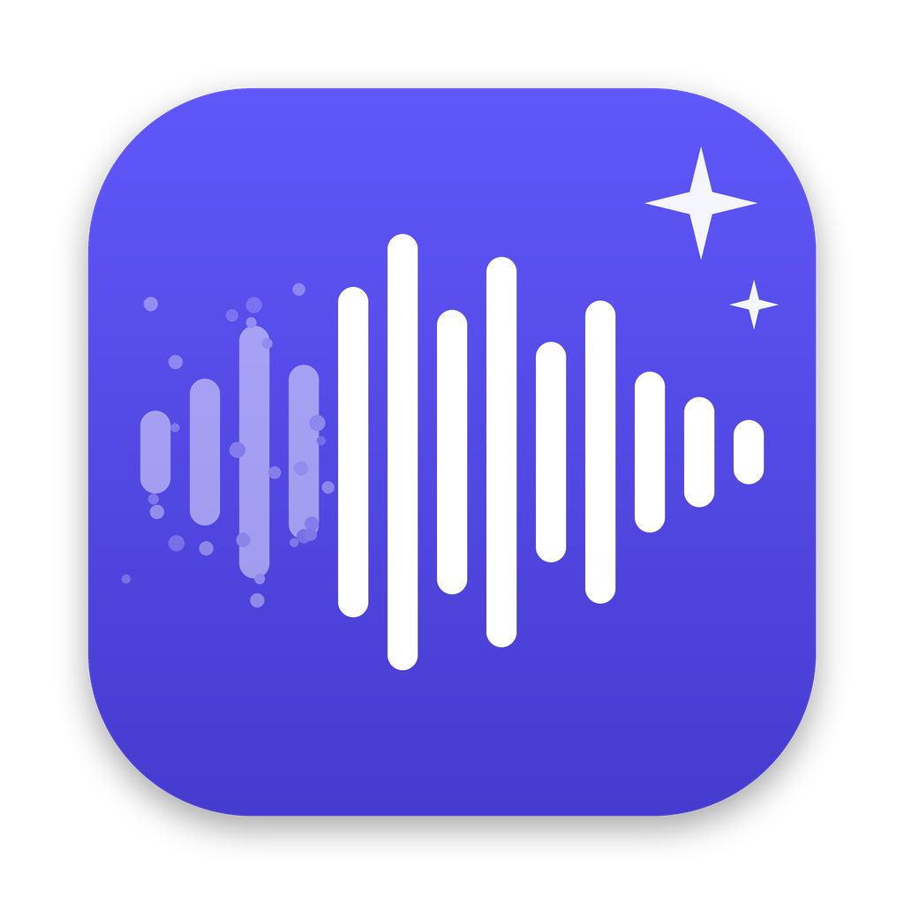
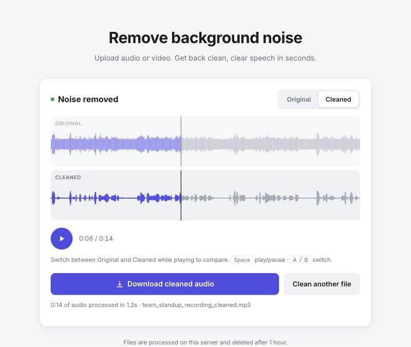

<p align="center">
  
</p>

<h1 align="center">Noise Remover</h1>

<p align="center">
  Self-hosted, AI-powered background noise removal for speech recordings.<br>
  Upload audio or video, compare before and after, and download clean audio. It runs entirely on your own machine.
</p>

<p align="center">
  <a href="LICENSE"></a>
  
  
</p>

<p align="center">
  
</p>

## Why

Hosted noise-removal services mean uploading every recording to a third party, and often paying per minute. Noise Remover gives you the same workflow with a state-of-the-art open-source speech enhancement model, running locally on a regular CPU. Your audio never leaves your machine.

## Features

- **Neural noise suppression.** It uses [DeepFilterNet3](https://github.com/Rikorose/DeepFilterNet) to remove fans, hum, hiss, traffic, keyboard clatter and room noise while preserving the voice.
- **Almost any input.** WAV, MP3, M4A, FLAC, OGG, Opus, AAC, AIFF and more, as well as video files (MP4, MOV, MKV, WebM), where it extracts the audio track. Files can be up to 500 MB.
- **Faithful output.** The output keeps the original sample rate and channel layout, exported as WAV, MP3, FLAC or M4A (AAC).
- **Adjustable strength.** Full suppression, or a capped attenuation that leaves some natural room tone.
- **A/B comparison.** It shows both waveforms side by side and switches between original and cleaned during playback without losing your place.
- **Handles long recordings.** Audio is processed in overlapping, crossfaded chunks, so hour-long recordings use bounded memory.
- **Fast on CPU.** It typically runs 5–15× faster than real time on a laptop CPU, with no GPU required.
- **macOS Dock app** (optional). A one-click app with a custom icon that starts the server in the background and opens the UI.
- **Simple REST API** for scripting and integrations.

## Quick start

**Requirements:** Python 3.11 (DeepFilterNet doesn't publish wheels for 3.12+), macOS or Linux.

```bash
git clone https://github.com/occasionaljunk/noise-remover.git
cd noise-remover

# Using uv (recommended): https://docs.astral.sh/uv/
uv venv --python 3.11 .venv
uv pip install --python .venv/bin/python -r requirements.txt

# Or with plain pip:
# python3.11 -m venv .venv && .venv/bin/pip install -r requirements.txt

./run.sh
```

Open **http://localhost:8765**. The first start downloads the DeepFilterNet3 model weights, about 8 MB.

To make it available to others on your network, run it with `HOST=0.0.0.0 ./run.sh`. There is no authentication, so only do this on a trusted network.

## macOS app

You can build a Dock app that starts the server silently and opens the UI:

```bash
assets/build_app.sh        # creates "Noise Remover.app" in the project folder
```

Then drag **Noise Remover.app** to your Dock.
- **Click the icon** to start the server and open the page. Clicking it again while it's running reopens the page.
- **Quit the app** (⌘Q, or right-click → Quit) to stop the server.
- **Server output** goes to `server.log`.

The app must stay inside the project folder, because it locates the server relative to itself. As an alternative, double-click `Open Noise Remover.command` and `Stop Noise Remover.command` in Finder.

## How it works

```
upload ─► PyAV/FFmpeg decode ─► resample to 48 kHz ─► DeepFilterNet3 (per channel,
30 s chunks, 0.5 s crossfade) ─► resample to original rate ─► PyAV/FFmpeg encode ─► download
```

- **Backend:** FastAPI ([app.py](app.py)). Uploads become background jobs, and the UI polls for progress. Jobs run one at a time, because the model is not thread-safe. Files are deleted after one hour.
- **Frontend:** a single dependency-free HTML page ([static/index.html](static/index.html)). It renders waveforms with the Web Audio API and supports light and dark mode.
- **Strength:** 100% applies the model's full suppression. Lower values set DeepFilterNet's attenuation limit (about 6–50 dB), which blends some of the original signal back in.

## API

| Method | Endpoint | Description |
| --- | --- | --- |
| `POST` | `/api/jobs` | Multipart form with `file`, plus optional `output_format` (`wav` \| `mp3` \| `flac` \| `m4a`, default `wav`) and `strength` (0–100, default 100). Returns `{"id": "..."}`. |
| `GET` | `/api/jobs/{id}` | Job status: `status`, `stage`, `progress` (0–1), `duration`, `elapsed`, `error`. |
| `GET` | `/api/jobs/{id}/download` | The cleaned file. Add `?inline=true` to stream it instead of downloading. |

```bash
id=$(curl -s -F file=@meeting.m4a -F output_format=mp3 http://localhost:8765/api/jobs | jq -r .id)
until curl -s http://localhost:8765/api/jobs/$id | jq -e '.status == "done"' >/dev/null; do sleep 1; done
curl -o meeting_cleaned.mp3 http://localhost:8765/api/jobs/$id/download
```

## Limitations

- **Designed for speech.** Music and singing may be treated as noise and suppressed.
- **One job at a time.** Concurrent uploads queue. For heavy use, run it on a machine with more CPU cores or a CUDA GPU.
- **No authentication or rate limiting.** Run it locally or behind your own access control.

## Project structure

```
app.py                     FastAPI server and audio pipeline
static/index.html          Web UI
requirements.txt           Python dependencies
run.sh                     Start the server
assets/                    App icon, icon generator, AppleScript source and build script for the macOS app
*.command                  Finder launchers (macOS)
```

## Acknowledgements

This project stands on the shoulders of these open-source projects:

| Project | Used for | License |
| --- | --- | --- |
| [DeepFilterNet](https://github.com/Rikorose/DeepFilterNet) by Hendrik Schröter et al. | Speech enhancement model (DeepFilterNet3) | MIT / Apache-2.0 |
| [PyTorch](https://pytorch.org) & [torchaudio](https://github.com/pytorch/audio) | Model inference and resampling | BSD-3-Clause / BSD-2-Clause |
| [PyAV](https://github.com/PyAV-Org/PyAV) | Audio/video decoding and encoding | BSD-3-Clause |
| [FFmpeg](https://ffmpeg.org) (bundled with PyAV) | Codec and container support | LGPL / GPL |
| [FastAPI](https://fastapi.tiangolo.com) & [Starlette](https://www.starlette.io) | Web server and API | MIT / BSD-3-Clause |
| [Uvicorn](https://www.uvicorn.org) | ASGI server | BSD-3-Clause |
| [python-multipart](https://github.com/Kludex/python-multipart) | File upload parsing | Apache-2.0 |
| [NumPy](https://numpy.org) | Signal processing | BSD-3-Clause |
| [Pillow](https://python-pillow.org) | Generating the app icon | MIT-CMU |
| [Inter](https://rsms.me/inter/) via Google Fonts | UI typeface | SIL OFL 1.1 |
| [uv](https://github.com/astral-sh/uv) | Python and dependency management | MIT / Apache-2.0 |

If you use DeepFilterNet in research, please cite the [DeepFilterNet papers](https://github.com/Rikorose/DeepFilterNet#citation-guide).

## License

[MIT](LICENSE) © 2026 Anmol Parashar. Third-party components are licensed under their own terms, listed above.
